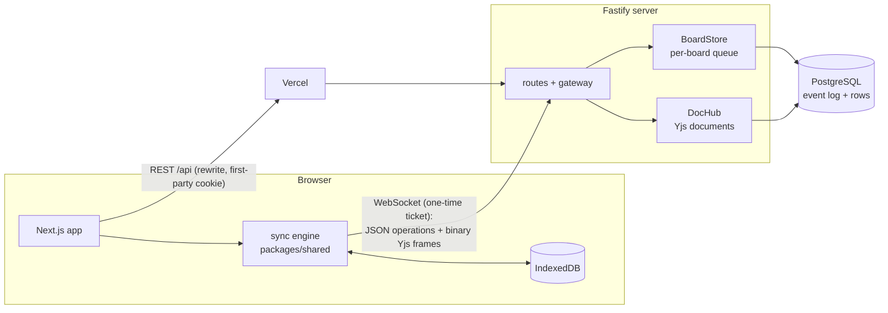

# Taskly

Real-time collaborative Kanban boards. Several people work on the same board and see every change as it
happens; card descriptions are written together, character by character, with everyone's cursor; work
done offline merges back when the connection returns, and the one real conflict (two people changing the
same field) is left to a person to decide instead of being silently overwritten.

**Live demo: [taskly-apenas.vercel.app](https://taskly-apenas.vercel.app)** · the demo gives you a board of your own, with a simulated
teammate who moves cards and writes while you watch (open the link in a second window to see both sides).


The interface is in Brazilian Portuguese; the code, docs and commits are in English.

## What it does

- **Live board.** Columns and cards with drag and drop (mouse, touch, keyboard), priority, due date and
  completion. Every change reaches everyone in the same order, in milliseconds.
- **Who is doing what.** Who has the board open, and who is editing or dragging which card, shown on the card
  in that person's colour.
- **Descriptions written together.** A rich-text description per card, edited by several people at once
  (Yjs CRDT + TipTap), each cursor labelled.
- **Conflicts with a choice.** Concurrent edits to different cards or fields just merge; two people changing
  the same field puts the late change in a **conflict tray** with "keep mine / keep theirs". A card deleted
  under someone's edit can be restored with the edit applied.
- **Offline.** Keep working with no connection; reloading loses nothing (IndexedDB); everything is sent and
  merged when the network returns.
- **Activity.** The board's history in sentences ("Ana moveu “Frete” de A fazer para Feito"), live.
- **No accounts.** A board is shared by a secret link; people join with a name and a colour.

## Architecture



An npm-workspaces monorepo:

| Package           | What it is                                                                          |
| ----------------- | ----------------------------------------------------------------------------------- |
| `packages/shared` | Protocol and sync engine used by both sides: Zod schemas, `decide()`, reducer, keys |
| `apps/server`     | Fastify + `ws`, the only writer to the database (Prisma 7, PostgreSQL)              |
| `apps/web`        | Next.js 16 (App Router) + Tailwind 4, dnd-kit, TipTap 3                             |

**How a change travels.** A click becomes an **operation** (`card.move`, `card.update`, …) with an id minted
by the client. The browser shows it at once by running the same `decide()` the server uses, and sends it.
The server runs it through **one write path, one board at a time**: it decides against the current board,
records the outcome as a numbered **event** (1, 2, 3… with no gaps) in the same transaction as the rows, and
broadcasts it from inside the board's queue, so everyone receives the same events in the same order.
Resending an operation returns its original event, so retries are harmless.

**Catching up.** A connection says `hello` with the last event number it has; inside the board's queue the
server sends what it missed (or a snapshot) and subscribes it, so nothing falls between catch-up and live.
Clients apply events strictly in order, wait out gaps (asking for the missing ones after 1.5 s), and drop a
pending operation only once the board has caught up with the server's answer.

The decisions behind this, with their trade-offs, are in [`docs/adr`](docs/adr):
[event log](docs/adr/0001-one-write-path-and-a-gapless-event-log.md) ·
[shared decisions and positions](docs/adr/0002-shared-decisions-and-server-positions.md) ·
[sync protocol](docs/adr/0003-sync-protocol.md) ·
[conflicts](docs/adr/0004-field-conflicts-and-the-tray.md) ·
[Yjs descriptions](docs/adr/0005-descriptions-as-yjs-documents.md) ·
[access and tickets](docs/adr/0006-access-by-link-and-one-time-tickets.md) ·
[offline](docs/adr/0007-offline-in-the-browser.md) ·
[free-plan deployment](docs/adr/0008-free-plan-deployment.md).

## Testing

| Layer                        | What it proves                                                                                                                                                                                                                                                     |
| ---------------------------- | ------------------------------------------------------------------------------------------------------------------------------------------------------------------------------------------------------------------------------------------------------------------ |
| Property tests (fast-check)  | Three clients against a model server, with messages reordered, duplicated and dropped and connections cut anywhere, all converge on the server's board and nothing is applied twice. Order keys stay unique and sorted under any insert sequence.                  |
| Server (Vitest + PostgreSQL) | Gapless numbering under concurrent REST and WebSocket writes, no event lost between catch-up and subscription, idempotent resends, tickets and `Origin`, conflicts, Yjs convergence and **merge between two server processes**, shutdown flush, the demo teammate. |
| Mutation checks              | Removing the per-board queue, subscribing before catching up, overwriting instead of merging, skipping the shutdown flush: each makes a test fail.                                                                                                                 |
| End to end (Playwright)      | Two browsers on one board: live drag; offline edits merging with the contested field in the tray; two people typing one description; reloading with unsent changes.                                                                                                |
| Load (`npm run load`)        | 50 clients on one board. Laptop core: p50 15 ms / p95 19 ms at 20 operations/s. Free-plan size (0.1 CPU, 512 MB): p50 16 ms / p95 268 ms at 1 op/s; p50 15 ms / p95 850 ms at 5 ops/s.                                                                             |

## Running locally

Requirements: Node.js 22.18+, Docker.

```bash
npm install
npm run db:up                           # PostgreSQL on localhost:5438
cp .env.example apps/server/.env
npm run db:migrate -w @taskly/server
npm run dev                             # server on :8030, web on http://localhost:3020
```

| Script                                        | Does                                                       |
| --------------------------------------------- | ---------------------------------------------------------- |
| `npm test`                                    | Unit, property and server integration tests (needs the DB) |
| `npm run build && npm run e2e`                | Playwright end-to-end tests against the production builds  |
| `npm run lint` / `typecheck` / `format:check` | Across all workspaces                                      |
| `npm run bot -w @taskly/server -- "<link>"`   | A bot that joins a board and keeps editing it              |
| `npm run load -w @taskly/server -- "<link>"`  | The load test (server with `TRUST_PROXY=true`)             |
| `docker build -f apps/server/Dockerfile .`    | Server image (applies migrations on start)                 |

## Deploying

- **Database:** Neon (PostgreSQL). The server uses the pooled connection; migrations use the direct one.
- **Server:** Render, from [`render.yaml`](render.yaml) (Docker, free plan, same region as the database).
- **Web:** Vercel, root directory `apps/web`, with `API_ORIGIN` (the server's https URL, for the `/api`
  rewrite) and `WS_ORIGIN` (its `wss://` origin, for the CSP).

## History

Taskly started as a single-user to-do list (Next.js API routes, Prisma 5). That version lives in the git
history; it was rebuilt into this one in eight stages, each a series of focused commits.
